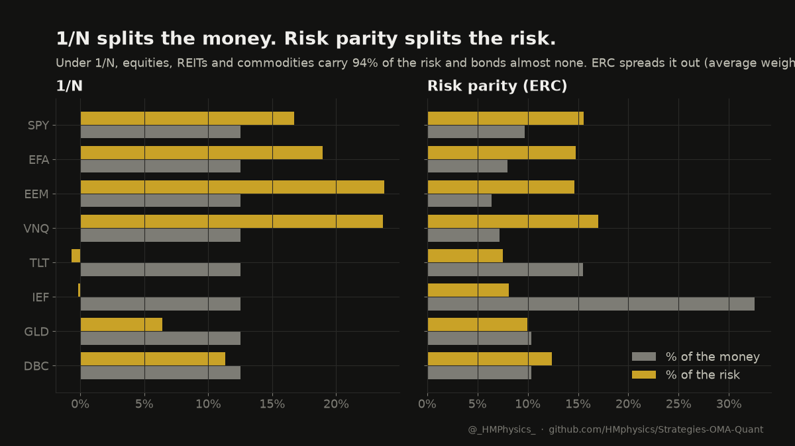
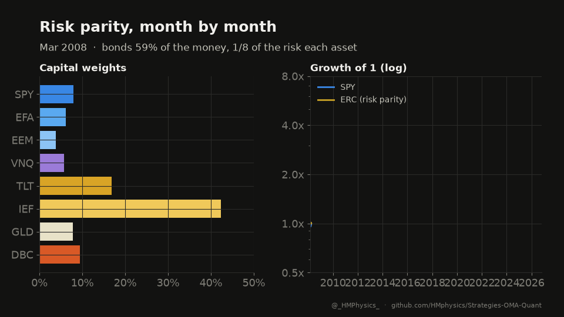
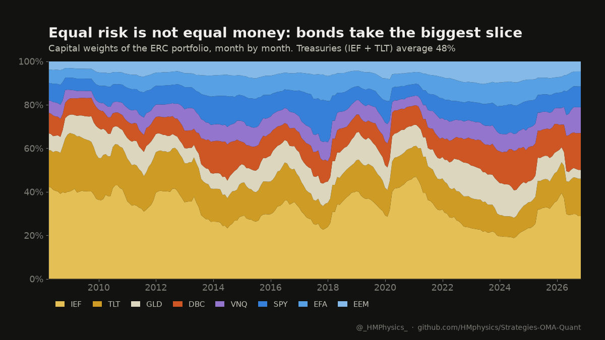
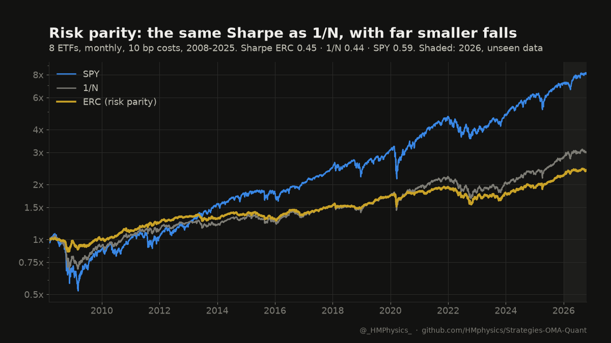
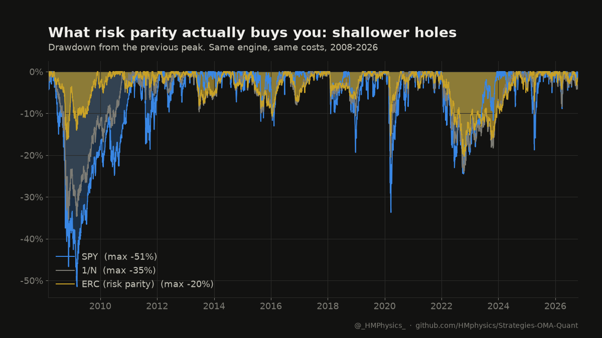
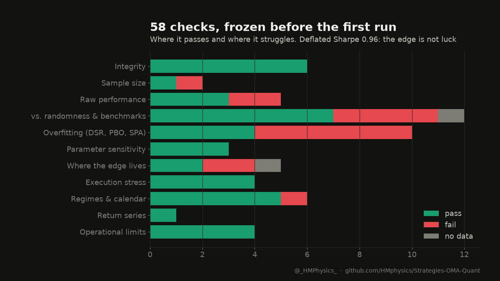

# Strategy 1 · Risk parity across eight asset classes

**Book 1 of 216** · Daniel P. Palomar, *Portfolio Optimization: Theory and Application* (Cambridge, 2025)

**[📖 Full episode on Substack](https://hmaquant.substack.com/p/216-quant-books-episode-1-risk-parity)** · **[🧵 Thread on X](https://x.com/_HMPhysics_/status/2125956425252048905)** · **[𝕏 @_HMPhysics_](https://x.com/_HMPhysics_)** · **[🎟️ 10% off OMA Quant with OMAQUANT-10](https://www.omaquant.com/pricing?cupon=OMAQUANT-10)**

> **English** below · **[Español más abajo](#-español)**

## The idea

Split the risk, not the money. Put 1/8 of your capital in each of eight ETFs and equities, REITs and commodities end up carrying about 94% of the risk. Risk parity solves, every month, for the weights where each asset contributes exactly 1/8 of the total risk. It needs no return forecasts at all.

## How it plays

| | |
|---|---|
| **Universe** | SPY, EFA, EEM, VNQ, TLT, IEF, GLD, DBC |
| **Rebalance** | Monthly, at the close of the last session |
| **Estimate** | Covariance of the last 252 daily returns |
| **Weights** | Equal risk contribution, long only, no leverage |
| **Costs** | 10 bp per side |
| **Sample** | March 2008 to December 2025, plus 2026 as unseen data |

Calm assets get more money: Treasuries average 48% of the capital. When volatility jumps, the weights rotate towards whatever is calm.

## The record

| Portfolio | Sharpe | CAGR | Vol | Max DD | 2026 Sharpe | 2026 Max DD |
|---|:-:|:-:|:-:|:-:|:-:|:-:|
| **Risk parity (ERC)** | **0.46** | **4.6%** | **7.8%** | **−20.3%** | **0.77** | **−4.3%** |
| Inverse volatility | 0.44 | 4.9% | 8.9% | −22.7% | 0.59 | −4.8% |
| 1/N | 0.44 | 5.9% | 11.7% | −35.4% | 0.45 | −8.4% |
| Hierarchical risk parity | 0.39 | 3.7% | 6.8% | −19.3% | −0.19 | −4.2% |
| Minimum variance, long only | 0.38 | 3.3% | 5.6% | −18.6% | 0.12 | −2.9% |
| SPY, buy and hold | 0.59 | 11.7% | 19.9% | −51.5% | 0.98 | −8.9% |

Same engine and costs for every line. 2026 runs from January to 19 October. Sharpe over the T-bill rate.

Same Sharpe as 1/N, with far smaller falls: −20% in 2008 against −35% for 1/N and −51% for SPY.

## What the engine checked

YGGDRASIL runs the same 58 checks on every strategy, with thresholds frozen before the first run. Every variant we look at raises the bar.

**Where it does well**
- Deflated Sharpe 0.96: after counting every variant, the edge is very unlikely to be luck.
- Execution stress: costs ×5, a day late or at the next open, it barely notices.
- Integrity and operational limits clean; positive in 13 of 18 years.

**Where it struggles**
- Sharpe 0.46 against a house bar of 0.8.
- 0.13 less Sharpe than SPY and about 7 points less a year.
- Probability of backtest overfitting 0.46: the best look-back window doesn't carry from one period to the next.
- Shuffling the weights doesn't hurt it: the returns come from what it holds, not from when it moves.

## The verdict

**Rejected by YGGDRASIL, and we agree.**

A good way to hold a portfolio for someone who can't sit through a −50% year: the same return per unit of risk as 1/N with half the pain. As a strategy we don't like it. The edge is real but small, it trails a plain index fund by about 7 points a year, and the only fix is leverage on bonds, which turns a calm portfolio into a bet on interest rates.

**[Open the full visual report](report.html)** (download and open in your browser).

---

## 🇪🇸 Español

**Estrategia 1 de la serie · Libro 1:** Palomar, *Portfolio Optimization* (2025).

**La idea.** Repartir el riesgo, no el dinero. Con 1/N, la bolsa, el inmobiliario y las materias primas cargan con el 94 % del riesgo. Risk parity busca cada mes los pesos con los que cada activo aporta exactamente 1/8 del riesgo, sin predecir rentabilidades.

**Cómo juega.** Ocho ETF (SPY, EFA, EEM, VNQ, TLT, IEF, GLD y DBC), rebalanceo mensual, covarianza de un año, solo largos y sin apalancamiento, con 10 pb de coste por lado. Los activos tranquilos reciben más dinero: los bonos del Tesoro se llevan de media el 48 %.

**Resultados 2008-2025.** Sharpe 0,46, casi igual que 1/N (0,44). Caída máxima de −20 %, frente a −35 % de 1/N y −51 % de SPY. CAGR del 4,6 %, frente al 11,7 % de SPY.

**El motor.** 58 comprobaciones fijadas antes de empezar.
- Lo bueno: Sharpe deflactado de 0,96, así que la ventaja es real, y aguanta costes ×5 y la ejecución tarde.
- Lo malo: el Sharpe queda lejos del 0,8 que exigimos, no bate a SPY y la mejor ventana de un periodo no sirve en el siguiente.

**Veredicto: rechazada por YGGDRASIL, y estamos de acuerdo.** Como forma de tener una cartera vale; como estrategia, no nos gusta: la ventaja es pequeña y solo se arregla apalancando bonos.

---

⭐ **[Star the repo](https://github.com/HMphysics/Strategies-OMA-Quant)** to follow the 216 books · 🎟️ **`OMAQUANT-10`** → **[10% off OMA Quant](https://www.omaquant.com/pricing?cupon=OMAQUANT-10)**

Book: Daniel P. Palomar, Portfolio Optimization: Theory and Application, Cambridge University Press, 2025 (free at portfoliooptimizationbook.com). Risk parity in 6.5.3 and chapter 11, HRP in chapter 12. Educational content, not financial advice. Backtests do not guarantee future returns.
