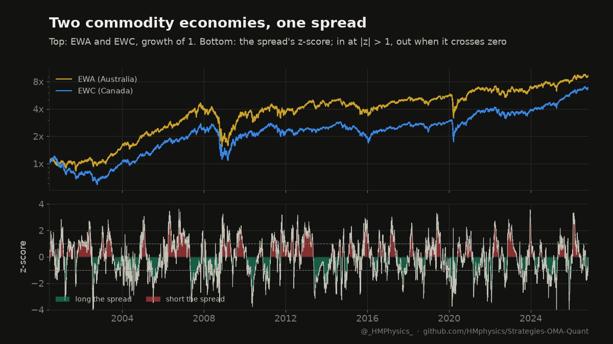
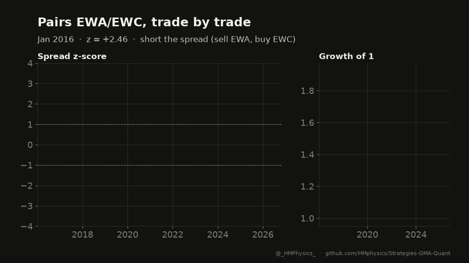
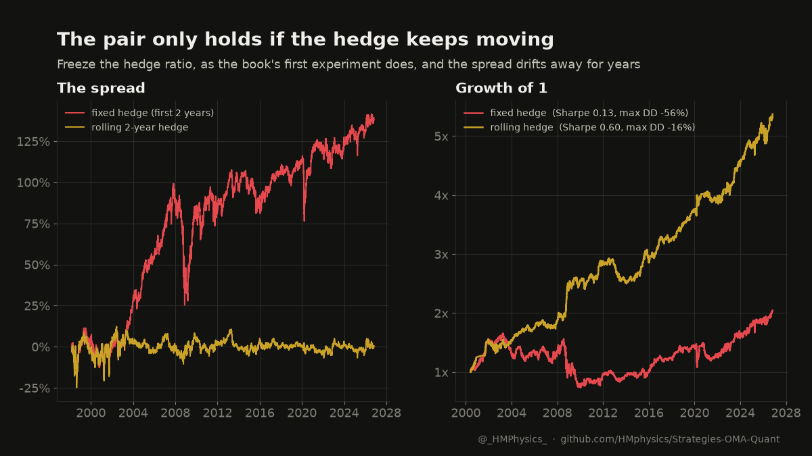
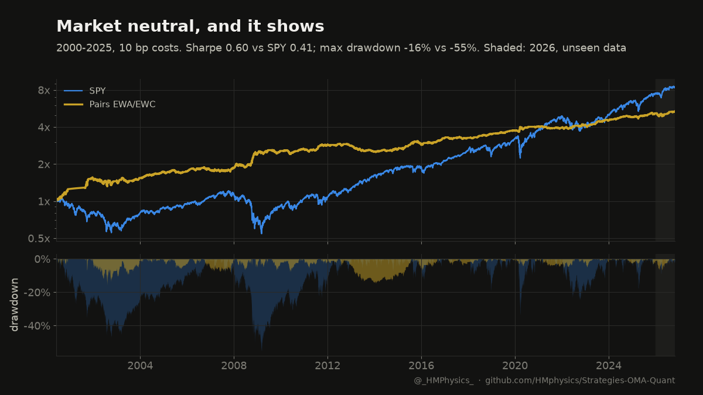
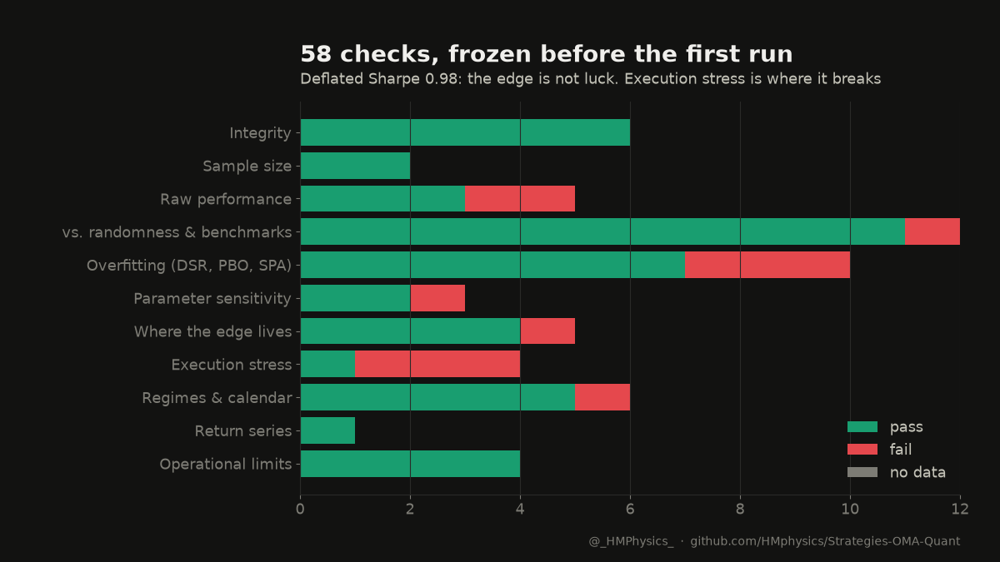
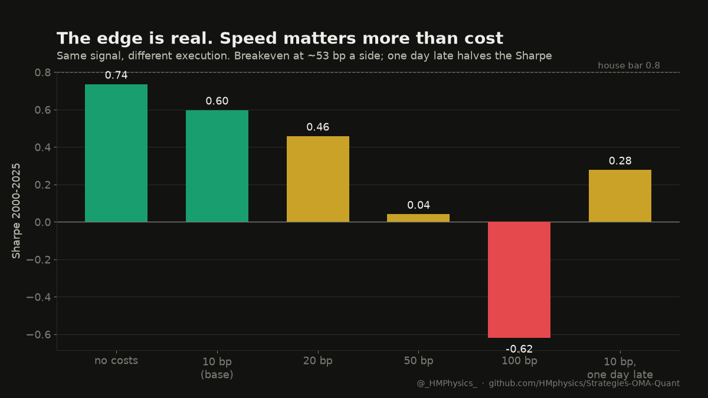

# Strategy 2 · Pairs trading Australia against Canada (EWA/EWC)

**216 Quant Books · Episode 2** · Book 1 of 216 · Daniel P. Palomar, *Portfolio Optimization: Theory and Application* (Cambridge, 2025)

**[📚 The series on Substack](https://hmaquant.substack.com/s/216-quant-books)** · **[𝕏 @_HMPhysics_](https://x.com/_HMPhysics_)** · **[🎟️ 10% off OMA Quant with OMAQUANT-10](https://www.omaquant.com/pricing?cupon=OMAQUANT-10)**

> **English** below · **[Español más abajo](#-español)**

## The idea

Australia and Canada are two commodity economies. Their stock markets, bought through the EWA and EWC ETFs, tend to move together, and when one runs ahead of the other the gap usually closes. Pairs trading bets on that: buy the laggard, short the leader, wait for the spread to come back. It's the book's own worked example of a market-neutral strategy.

## How it plays

| | |
|---|---|
| **Pair** | EWA (Australia) against EWC (Canada) |
| **Hedge ratio** | Regression of log EWA on log EWC over the last 504 sessions (two years), updated daily |
| **Signal** | z-score of the spread over 126 sessions. In when \|z\| > 1, out when it crosses zero |
| **Position** | Long the spread = buy EWA, short EWC in the hedge ratio. Gross exposure 1, no leverage |
| **Costs** | 10 bp per side, executed at the next close |
| **Sample** | June 2000 to December 2025, plus 2026 as unseen data |

About 11 round trips a year, almost no market exposure (beta 0.03 against SPY).

## The hedge has to move

The book starts with a hedge ratio estimated once and frozen. That version falls apart: the spread drifts away for years and the strategy loses 56% at its worst. Re-estimating the hedge every day on a rolling two-year window is what makes the pair hold.

## The record

| | Sharpe | CAGR | Vol | Max DD | 2026 Sharpe | 2026 Max DD |
|---|:-:|:-:|:-:|:-:|:-:|:-:|
| **Pairs EWA/EWC, rolling hedge** | **0.60** | **6.6%** | **8.4%** | **−15.7%** | **0.17** | **−5.9%** |
| Same signal, linear sizing | 0.55 | 6.1% | 8.0% | −15.6% | 0.52 | −6.4% |
| Fixed hedge (the book's first test) | 0.13 | 2.5% | 17.0% | −55.5% | 0.52 | −7.0% |
| SPY, buy and hold | 0.41 | 8.2% | 19.2% | −55.2% | 0.98 | −8.9% |

Same engine and costs for every line. 2026 runs from January to October. Sharpe over the T-bill rate.

Better Sharpe than the index over 25 years, with a quarter of its worst fall, and positive in 19 of 26 years. 2008 was its best year.

## What the engine checked

YGGDRASIL runs the same 58 checks on every strategy, with thresholds frozen before the first run. Every variant we look at raises the bar.

**Where it does well**
- Deflated Sharpe 0.98: after counting every variant, the edge is very unlikely to be luck.
- Alpha of 4.7% a year against SPY (t = 3.3) with a beta of 0.03. Truly market neutral.
- Timing matters: shuffling or shifting the positions kills it. The returns come from *when* it trades, which is what a pairs trade should look like.
- Integrity, sample size and operational limits clean.

**Where it struggles**

- Sharpe 0.60 against a house bar of 0.8.
- Execution. About 12x turnover a year. The edge breaks even at 53 bp per side, far above what these two ETFs really cost to trade, so the engine's 50 bp stress test (Sharpe 0.04) is harsh on this pair. Speed is the real issue: trade one day late and the Sharpe drops to 0.28, because the spread snaps back fast.
- Probability of backtest overfitting 0.54 to 0.64: a two-year hedge window works, one or three years don't (Sharpe 0.36 and 0.39).
- Long dead spells. Worst rolling year 2013, a rolling-year Sharpe below zero for 356 sessions in a row, and 2026 so far is flat (Sharpe 0.17).

## The verdict

**A middle-ground strategy. It doesn't clear YGGDRASIL's bar and it doesn't convince us, but it isn't a bad strategy either.**

The cleanest edge of the series so far: real, market neutral, a better Sharpe than the index with a quarter of its worst fall, and not a product of luck. Some of the tests that sink it are harsh on a pair of liquid ETFs. What keeps us from running it is the rest: a Sharpe below our 0.8 bar, only one hedge window that works, and an edge that fades fast if you trade a day late. Worth knowing and worth studying, not quite worth our capital. And the lesson is a big one: the book's own pairs trade only survives if the hedge keeps moving.

**[Open the full visual report](report.html)** (download and open in your browser).

---

## 🇪🇸 Español

**216 libros quant · Episodio 2 · Estrategia 2 de la serie · Libro 1:** Palomar, *Portfolio Optimization* (2025).

**La idea.** Australia y Canadá son dos economías de materias primas y sus bolsas (los ETF EWA y EWC) se mueven juntas. Cuando una se adelanta, el hueco suele cerrarse. El pairs trading compra la rezagada, vende la adelantada y espera. Es el ejemplo del propio libro.

**Cómo juega.** Cobertura por regresión de los dos últimos años, recalculada cada día. z-score del diferencial a seis meses: entra con |z| > 1 y sale al cruzar el cero. Unas 11 operaciones al año, exposición bruta 1, sin apalancamiento y con 10 pb por lado. Beta de 0,03 con el SPY.

**La cobertura tiene que moverse.** Con la cobertura fija del primer experimento del libro, el diferencial se va durante años y la caída máxima llega al −56 %. Con la cobertura móvil, el par aguanta.

**Resultados 2000-2025.** Sharpe 0,60 frente a 0,41 del SPY, CAGR del 6,6 % y caída máxima del −16 % frente al −55 % del índice. Positiva en 19 de 26 años.

**El motor.** 58 comprobaciones fijadas antes de empezar.
- Lo bueno: Sharpe deflactado de 0,98, alfa del 4,7 % anual con t = 3,3 y beta casi cero. El edge es real y neutral al mercado.
- Lo malo: el Sharpe queda por debajo del 0,8 que exigimos y solo funciona con la ventana de dos años. Con un día de retraso baja a 0,28 y en 2026 va casi plana. La prueba de costes ×5 (0,04) es dura para dos ETF tan líquidos: el coste de equilibrio está en 53 pb por lado.

**Veredicto: una estrategia media.** No pasa el listón de YGGDRASIL y no nos acaba de convencer, pero tampoco es mala: es el edge más limpio de la serie hasta ahora, neutral al mercado y con mejor Sharpe que el índice. Le falta Sharpe, depende de una sola ventana y pierde mucho si se ejecuta tarde. Para conocerla y estudiarla, sí; para meterle capital, todavía no.

---

⭐ **[Star the repo](https://github.com/HMphysics/Strategies-OMA-Quant)** to follow the 216 books · 🎟️ **`OMAQUANT-10`** → **[10% off OMA Quant](https://www.omaquant.com/pricing?cupon=OMAQUANT-10)**

Book: Daniel P. Palomar, Portfolio Optimization: Theory and Application, Cambridge University Press, 2025 (free at portfoliooptimizationbook.com). Pairs trading in sections 15.4.5 to 15.6, with this same pair. Educational content, not financial advice. Backtests do not guarantee future returns.
