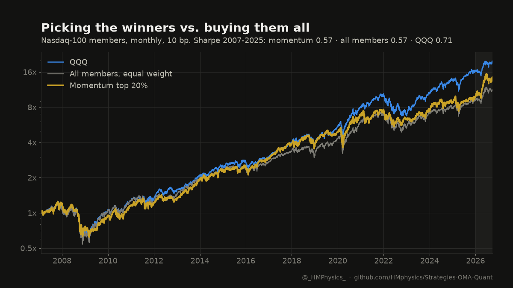
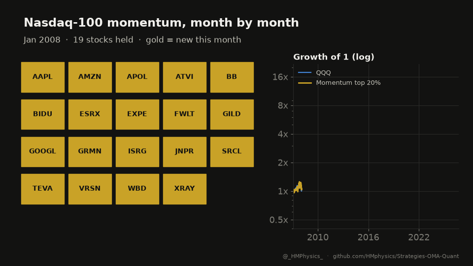
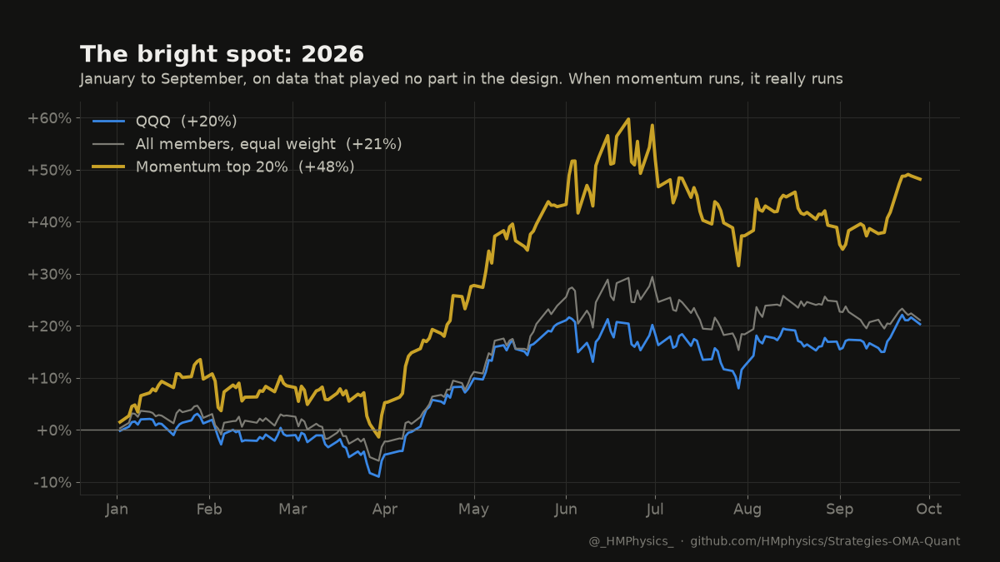
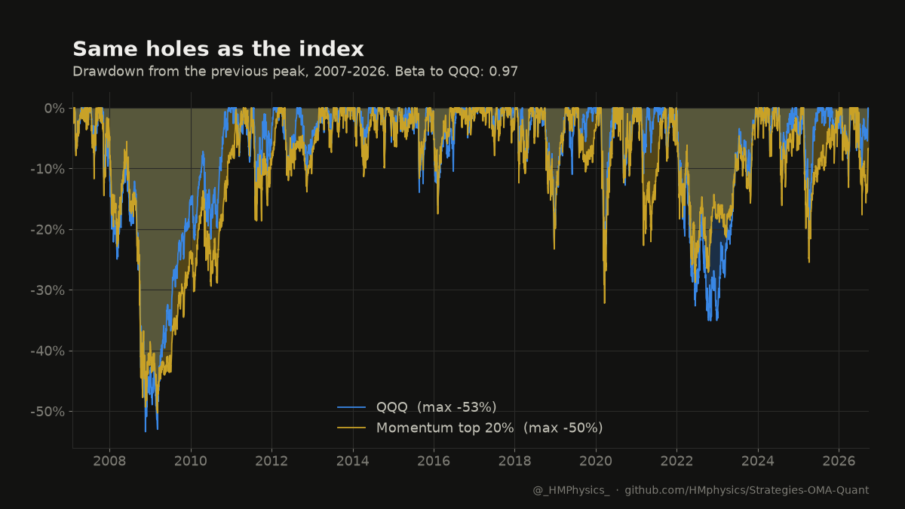
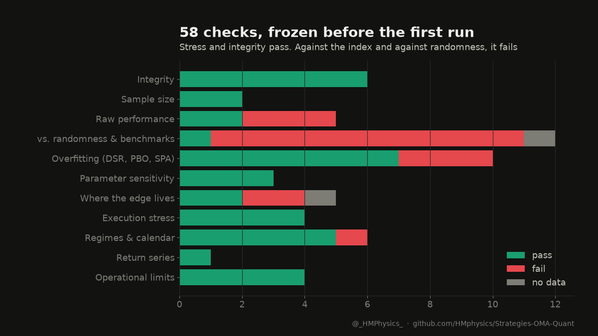
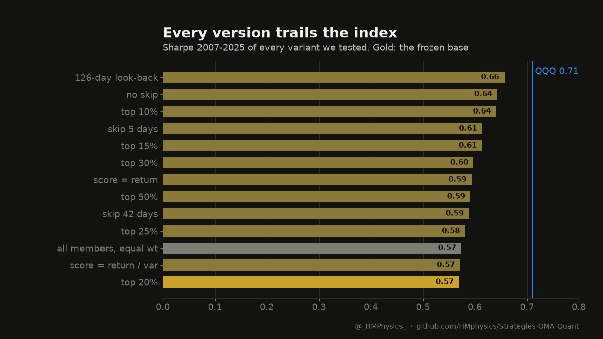
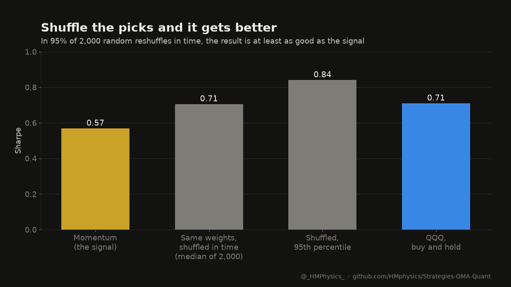

# Strategy 3 · Momentum across the Nasdaq-100

**216 Quant Books · Episode 3** · Book 1 of 216 · Daniel P. Palomar, *Portfolio Optimization: Theory and Application* (Cambridge, 2025)

**[📚 The series on Substack](https://hmaquant.substack.com/s/216-quant-books)** · **[𝕏 @_HMPhysics_](https://x.com/_HMPhysics_)**

> **English** below · **[Español más abajo](#-español)**

## The idea

Winners keep winning, at least for a while. The book's quintile portfolio puts that to work in the simplest way: rank the stocks by how well they did over the last year, adjusted for risk, buy the top fifth and repeat every month. We ran it on the Nasdaq-100, with the index members of each year, so no stock gets in before it actually joined.

## How it plays

| | |
|---|---|
| **Universe** | Nasdaq-100 members at the start of each year (2007-2026), point in time |
| **Score** | Mean daily return divided by its volatility over the last 12 months, skipping the most recent month |
| **Portfolio** | The top 20% (about 20 stocks), equal weight, long only |
| **Rebalance** | Monthly, at the close of the last session |
| **Costs** | 10 bp per side |
| **Sample** | February 2007 to December 2025, plus 2026 as unseen data |

About a quarter of the portfolio changes every month.

## The record

| | Sharpe | CAGR | Vol | Max DD | 2026 Sharpe | 2026 Max DD |
|---|:-:|:-:|:-:|:-:|:-:|:-:|
| **Momentum, top 20%** | **0.57** | **12.8%** | **23.5%** | **−50.3%** | **1.71** | **−17.6%** |
| All members, equal weight | 0.57 | 12.4% | 22.3% | −55.2% | 1.17 | −10.9% |
| QQQ, buy and hold | 0.71 | 15.9% | 22.3% | −53.4% | 1.16 | −11.7% |

Same engine and costs for every line. 2026 runs from January to 28 September, the last date with prices for every member. Sharpe over the T-bill rate.

Nearly 13% a year for 19 years, positive in 17 of them. And 2026, data that played no part in the design, has been spectacular.

**+48% to the end of September, against +20% for QQQ**, with a Sharpe of 1.71. When momentum runs, it really runs. On its own, this looks like a great strategy.

## What the engine checked

YGGDRASIL runs the same 58 checks on every strategy, with thresholds frozen before the first run. This one shows why comparing against the right benchmark matters.

**Where it does well**
- Execution stress, clean: costs ×5 still leave a Sharpe of 0.46, and a day late it barely moves (0.56).
- Stable: every variant we tried lands between 0.57 and 0.66. Nothing hinges on one lucky parameter.
- A brilliant 2026 on unseen data: +48% to September against +20% for QQQ.
- Deflated Sharpe 0.99, integrity and operational limits clean, positive in 17 of 19 years.

**Where it struggles**

- Every version trails QQQ. Top 10% or top 50%, six months or a year, with or without skipping the last month: none reaches the index's 0.71.
- Picking adds nothing. Buying **all** the members at equal weight gives the same Sharpe (0.57). Beta to QQQ is 0.97 and the alpha is negative (−2% a year).
- The timing test fails. Take the same portfolios and shuffle which month gets which: 95% of the shuffles do at least as well as the real signal.

- The result rests on a few trades. Without its five best trades the Sharpe falls from 0.57 to 0.13.
- Worst fall −50.3%, just past the house limit of −50%.

## The verdict

**Not accepted by YGGDRASIL, and we agree.**

The engine sees through it: this is the Nasdaq-100 with more turnover. The high deflated Sharpe is measuring the index, not the signal, and every version of the idea trails a plain QQQ. 2026 is a reminder of why momentum is so tempting, and it deserves a place on the watch list: in years like this one it more than doubles the index. But a single great year doesn't change 19 years of evidence. As a lesson it's one of the best in the series: always ask what your strategy beats once you take the market out. As a strategy, we don't like it.

**[Open the full visual report](report.html)** (download and open in your browser).

---

## 🇪🇸 Español

**216 libros quant · Episodio 3 · Estrategia 3 de la serie · Libro 1:** Palomar, *Portfolio Optimization* (2025).

**La idea.** Lo que sube tiende a seguir subiendo durante un tiempo. La cartera de quintil del libro lo aplica de la forma más simple: ordena las acciones por su rentabilidad ajustada al riesgo del último año, compra el quinto mejor y repite cada mes. La probamos en el Nasdaq-100 con los miembros de cada año, sin que entre ninguna acción antes de tiempo.

**Cómo juega.** Puntuación = rentabilidad media diaria entre su volatilidad en 12 meses, saltándose el último mes. Compra el 20 % mejor (unas 20 acciones) a igual peso, solo largos, rebalanceo mensual y 10 pb por lado.

**Resultados 2007-2025.** Sharpe 0,57, CAGR del 12,8 % y caída máxima del −50 %. QQQ: Sharpe 0,71, CAGR del 15,9 % y −53 %. En 2026 (datos no vistos) va un **+48 % hasta septiembre, frente al +20 % del QQQ**: cuando el momentum funciona, funciona de verdad.

**El motor.** 58 comprobaciones fijadas antes de empezar.
- Lo bueno: aguanta costes ×5 y el retraso, todas las variantes dan un Sharpe parecido (0,57-0,66) y es positiva en 17 de 19 años.
- Lo malo: ninguna versión bate al QQQ; comprar todos los miembros a igual peso da lo mismo (beta 0,97, alfa negativo); barajar los meses no la empeora; sin sus 5 mejores operaciones el Sharpe cae a 0,13.

**Veredicto: no aceptada por YGGDRASIL, y estamos de acuerdo.** Es el Nasdaq-100 con más rotación, aunque años como 2026 la hacen digna de seguir. Como lección vale mucho: pregúntate siempre qué bate tu estrategia cuando le quitas el mercado. Como estrategia, no nos gusta.

---

**🌳 About YGGDRASIL and OMA Quant**

YGGDRASIL is the audit engine behind this series: the verdict is sealed before the backtest, every strategy faces 58 checks, and every attempt raises the bar.
It's built by **[OMA Quant](https://www.omaquant.com/pricing?cupon=OMAQUANT-10)**, a quantitative research house for independent investors: live strategy signals, macro and derivatives research, market data and research tools.
Run the same engine on your own strategies with **[OMA Lab](https://www.omaquant.com/lab?cupon=OMAQUANT-10)**.

*YGGDRASIL es el motor de auditoría de esta serie: el veredicto se sella antes del backtest, cada estrategia pasa 58 comprobaciones y cada intento sube el listón. Lo construye [OMA Quant](https://www.omaquant.com/pricing?cupon=OMAQUANT-10), una casa de research cuantitativo para inversores independientes.*

⭐ **[Star the repo](https://github.com/HMphysics/Strategies-OMA-Quant)** to follow the 216 books · If it's useful, share it: **`OMAQUANT-10`** gives you **[10% off OMA Quant](https://www.omaquant.com/pricing?cupon=OMAQUANT-10)**

Book: Daniel P. Palomar, Portfolio Optimization: Theory and Application, Cambridge University Press, 2025 (free at portfoliooptimizationbook.com). Quintile portfolio in section 6.4.4. Index membership by year; survivorship bias is reduced but not fully removed. Educational content, not financial advice. Backtests do not guarantee future returns.
