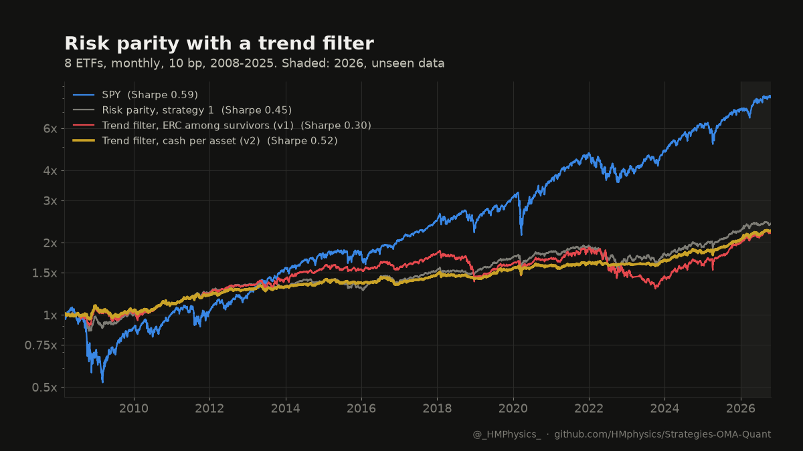
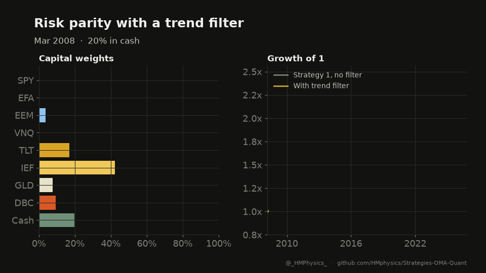
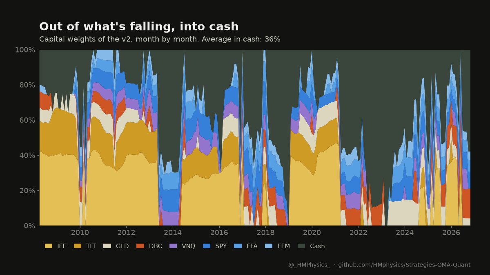
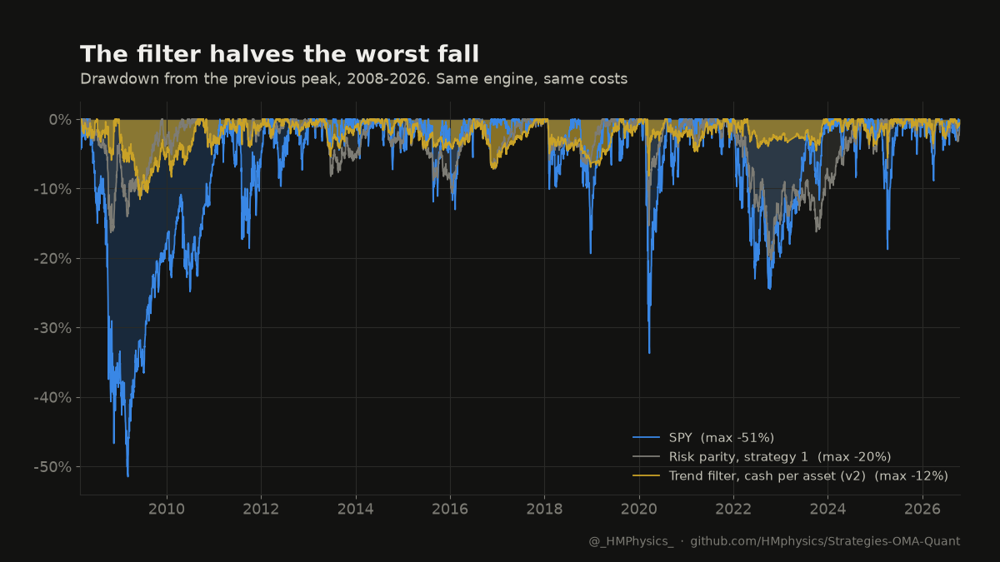
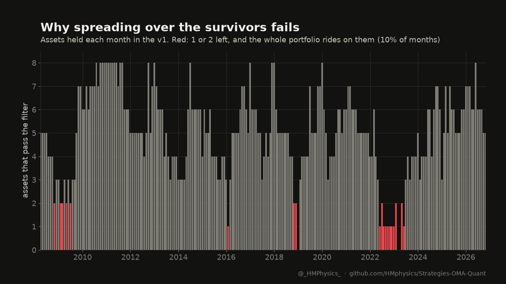
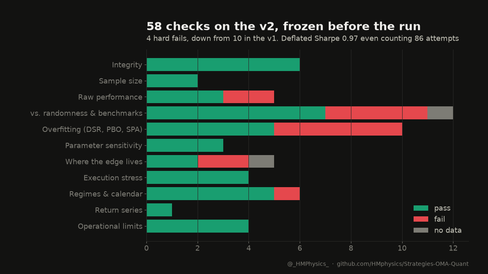

# Strategy 4 · Risk parity with a 12-month trend filter

**216 Quant Books · Episode 4** · Variants of **[Strategy 1 · Risk parity across eight asset classes](../001-risk-parity)** · Book 1 · Daniel P. Palomar, *Portfolio Optimization* (2025)

**[📚 The series on Substack](https://hmaquant.substack.com/s/216-quant-books)** · **[𝕏 @_HMPhysics_](https://x.com/_HMPhysics_)**

> **English** below · **[Español más abajo](#-español)**

## The idea

[Strategy 1](../001-risk-parity) split the risk evenly across eight asset classes and got the same Sharpe as 1/N with half the drawdown. Its weak spots were the long falls when several assets went down together: 2008 and 2022.

So we added the oldest rule in tactical allocation: **only hold what is going up**. Every month, each asset has to beat the T-bill over the last twelve months to stay in the portfolio. We tested two ways of doing it:

- **v1, spread over the survivors:** risk parity only among the assets that pass; if none pass, all cash.
- **v2, cash per asset:** risk parity across all eight as before, and each asset that fails the filter hands its slice to cash.

## How it plays

Same eight ETFs (SPY, EFA, EEM, VNQ, TLT, IEF, GLD, DBC), monthly, one-year covariance, long only, no leverage, 10 bp per side. In the v2 the cash share moves with the market: almost none in calm uptrends, most of the portfolio in 2008 and 2022. On average about a third sits in T-bills.

## The record

| | Sharpe | CAGR | Vol | Max DD | Calmar | 2026 Sharpe |
|---|:-:|:-:|:-:|:-:|:-:|:-:|
| **v2: trend filter, cash per asset** | **0.52** | **4.1%** | **5.6%** | **−11.6%** | **0.35** | **1.23** |
| v1: trend filter, spread over survivors | 0.30 | 3.9% | 10.2% | −32.8% | 0.12 | 1.12 |
| Strategy 1: risk parity, no filter | 0.46 | 4.6% | 7.8% | −20.3% | 0.23 | 0.77 |
| SPY, buy and hold | 0.59 | 11.7% | 19.9% | −51.5% | 0.23 | 0.98 |

March 2008 to December 2025, same engine and costs for every line. 2026 runs from January to October. Calmar = CAGR / |max drawdown|.

The v2 does what the filter promises: the worst fall goes from −20% to −12%, and per point of drawdown it earns more than both strategy 1 and the S&P 500.

The v1 is a warning. When only one or two assets pass the filter, "risk parity among the survivors" puts the whole portfolio on them. That happened in 2022, when bonds were falling too, and it made things worse than having no filter at all.

## What the engine checked

YGGDRASIL ran the same 58 checks on both versions. Because this idea came after seeing strategy 1, and the v2 after seeing the v1, every attempt counts against it: the deflated Sharpe is computed against 86 attempts.

**Where the v2 does well**
- Deflated Sharpe 0.97 even counting 86 attempts: the improvement is not luck.
- Execution stress, clean: costs ×5 still give 0.41, a day late 0.52.
- Worst quarter −5.5%, beta 0.06 to the S&P 500 and a positive alpha (+2.2% a year).
- A strong 2026 so far on unseen data (Sharpe 1.23).

**Where it struggles**
- Sharpe 0.52 against a house bar of 0.8, and still below SPY's 0.59.
- About 4% a year: the filter protects, it doesn't add return.
- The timing test doesn't clear the bar (p = 0.16), and without its five best trades the Sharpe falls to 0.13.
- The best look-back changes from period to period (overfitting probability 0.82).

## The verdict

**🟡 A middle-ground strategy. It doesn't clear YGGDRASIL's bar, but it's the best version of risk parity in the series so far.**

The trend filter, done the right way, does exactly what you'd want from it: it cuts the worst fall nearly in half, earns more per point of drawdown than the S&P 500, and survives costs and delays. Done the wrong way it concentrates the portfolio and does damage. What it can't do is turn a calm 4%-a-year portfolio into a strategy with a high Sharpe. Worth knowing and worth studying, not quite worth our capital.

**[Open the full visual report](report.html)** (download and open in your browser).

---

## 🇪🇸 Español

**216 libros quant · Episodio 4 · Estrategia 4 de la serie.** Variantes de la **[estrategia 1 (risk parity)](../001-risk-parity)**, libro 1: Palomar, *Portfolio Optimization* (2025).

**La idea.** A la risk parity de la estrategia 1 le añadimos un filtro de momentum de 12 meses: cada activo tiene que batir a las letras del Tesoro en el último año para quedarse. v1: risk parity solo entre los que pasan. v2: risk parity sobre los 8 y el peso de cada activo que no pasa va a liquidez.

**Resultados 2008-2025.** v2: Sharpe 0,52, CAGR del 4,1 %, caída máxima del −11,6 % y Calmar de 0,35 (la estrategia 1: 0,46, −20,3 % y 0,23; el SPY: 0,59, −51,5 % y 0,23). v1: Sharpe 0,30 y −32,8 %, porque se concentra en uno o dos activos cuando pasan pocos.

**El motor.** Sharpe deflactado de 0,97 contando 86 intentos, aguanta costes ×5 y el retraso, y tiene alfa positivo. Falla el Sharpe (0,52 frente a 0,8), el timing y la dependencia de las mejores operaciones.

**Veredicto: 🟡 estrategia media.** No pasa el listón, pero es la mejor risk parity de la serie: casi divide por dos la caída y gana más por punto de drawdown que el S&P 500. Para conocerla y estudiarla, sí; para meterle capital, todavía no.

---

**🌳 About YGGDRASIL and OMA Quant**

YGGDRASIL is the audit engine behind this series: the verdict is sealed before the backtest, every strategy faces 58 checks, and every attempt raises the bar.
It's built by **[OMA Quant](https://www.omaquant.com/pricing?cupon=OMAQUANT-10)**, a quantitative research house for independent investors: live strategy signals, macro and derivatives research, market data and research tools.
Run the same engine on your own strategies with **[OMA Lab](https://www.omaquant.com/lab?cupon=OMAQUANT-10)**.

*YGGDRASIL es el motor de auditoría de esta serie: el veredicto se sella antes del backtest, cada estrategia pasa 58 comprobaciones y cada intento sube el listón. Lo construye [OMA Quant](https://www.omaquant.com/pricing?cupon=OMAQUANT-10), una casa de research cuantitativo para inversores independientes.*

⭐ **[Star the repo](https://github.com/HMphysics/Strategies-OMA-Quant)** to follow the 216 books · If it's useful, share it: **`OMAQUANT-10`** gives you **[10% off OMA Quant](https://www.omaquant.com/pricing?cupon=OMAQUANT-10)**

Parent strategy: [Strategy 1 · Risk parity across eight asset classes](../001-risk-parity). The 12-month absolute momentum filter follows Antonacci and Faber. Educational content, not financial advice. Backtests do not guarantee future returns.
