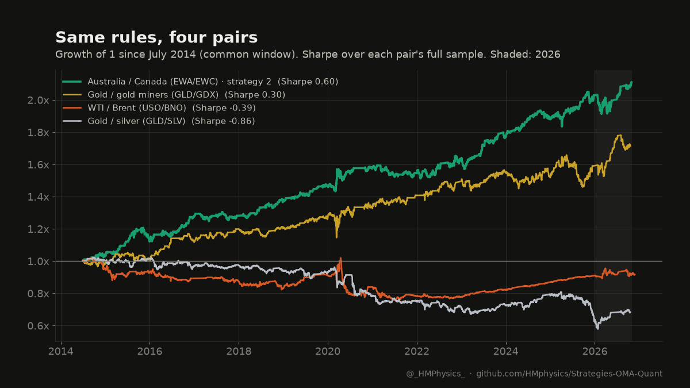
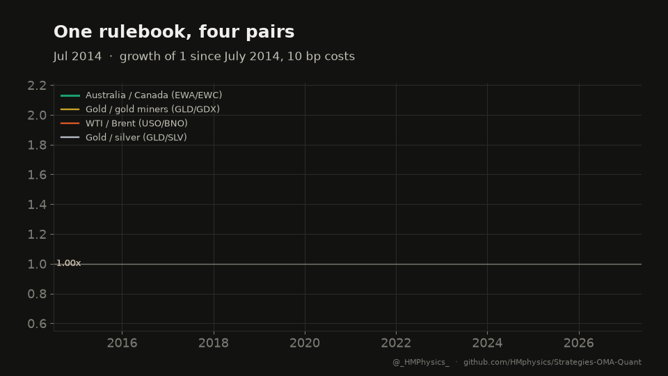
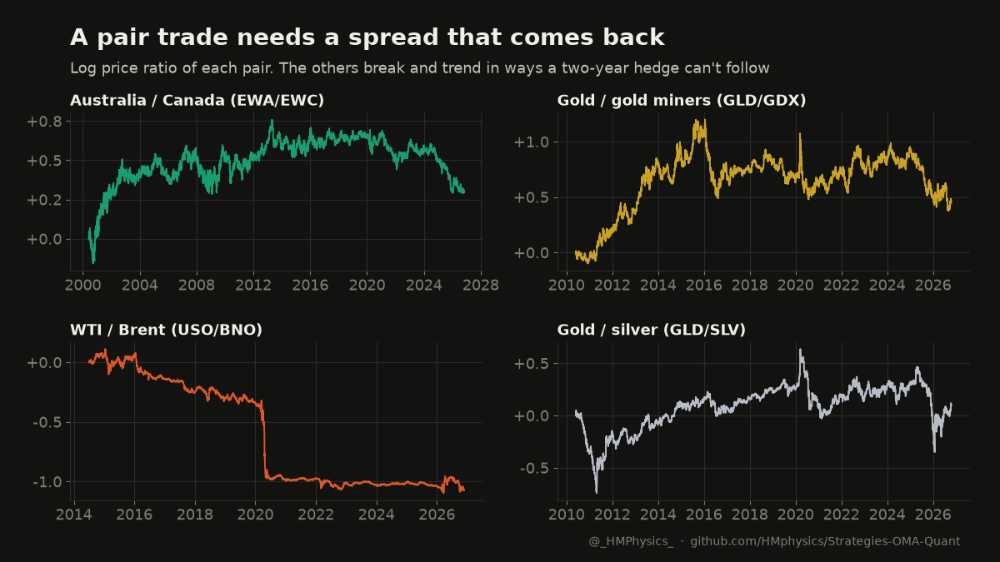
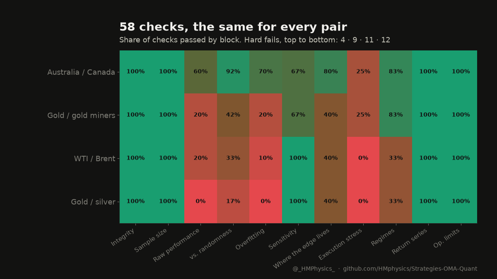
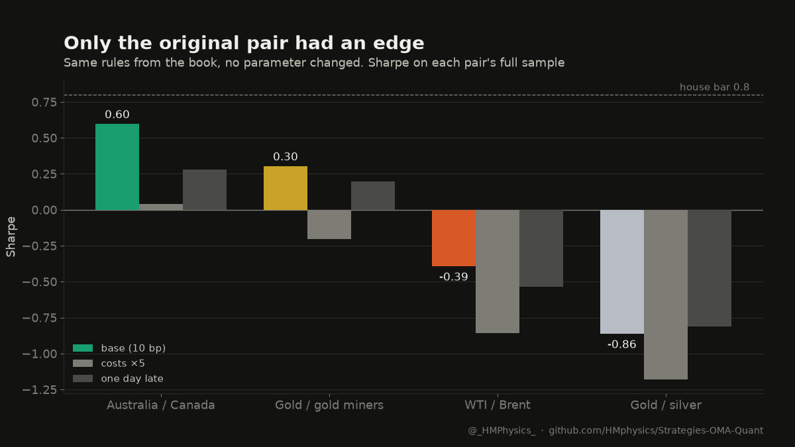

# Strategy 5 · The pairs rulebook on three new pairs

**216 Quant Books · Episode 5** · Variants of **[Strategy 2 · Pairs trading Australia against Canada](../002-pairs-ewa-ewc)** · Book 1 · Daniel P. Palomar, *Portfolio Optimization* (2025)

**[📚 The series on Substack](https://hmaquant.substack.com/s/216-quant-books)** · **[𝕏 @_HMPhysics_](https://x.com/_HMPhysics_)**

> **English** below · **[Español más abajo](#-español)**

## The idea

[Strategy 2](../002-pairs-ewa-ewc) found a real, market-neutral edge in Australia against Canada, using the pairs rules from Palomar's book. The obvious next question: does the same rulebook work on other pairs that "should" move together?

We picked three classic ones and changed **nothing** but the pair:

- **Gold / silver** (GLD/SLV): two precious metals.
- **Gold / gold miners** (GLD/GDX): the metal against the companies that dig it out.
- **WTI / Brent** (USO/BNO): two benchmarks for the same barrel of oil.

Same hedge (a rolling two-year regression), same six-month z-score, in at |z| > 1, out at zero, 10 bp per side.

## How it plays

A pairs trade only works if the spread keeps coming back to where it was. Australia and Canada drift slowly around a level. The other three don't: gold and the miners went their own way for years, silver jumps on its own news, and WTI against Brent broke for good in 2020 when the oil market and the ETFs themselves changed.

## The record

| Pair | Sample | Sharpe | CAGR | Max DD | Years positive | 2026 Sharpe |
|---|---|:-:|:-:|:-:|:-:|:-:|
| *Australia / Canada (strategy 2)* | *2000-2025* | *0.60* | *6.6%* | *−15.7%* | *19 of 26* | *0.17* |
| **Gold / gold miners** | 2010-2025 | **0.30** | **3.5%** | **−22.4%** | **12 of 16** | **0.68** |
| **WTI / Brent** | 2014-2025 | **−0.39** | **−0.8%** | **−25.7%** | **4 of 12** | **−0.47** |
| **Gold / silver** | 2010-2025 | **−0.86** | **−5.4%** | **−59.5%** | **3 of 16** | **0.53** |

Same engine and costs for every line. Each pair starts once there are four years of data for the slowest variant tested. Sharpe over the T-bill rate.

## What the engine checked

YGGDRASIL ran the same 58 checks on each pair. Because these pairs were chosen after seeing strategy 2, every attempt counts against them: the bar for the deflated Sharpe already includes the 19 configurations tried on Australia/Canada and the other two pairs.

**Where it does well**
- Gold against the miners keeps something: a Sharpe of 0.30, positive in 12 of 16 years and a good 2026 so far (0.68).
- Integrity, sample size and operational limits are clean on all three.
- A clean experiment: the rules were frozen before running anything, so the comparison between pairs is fair.

**Where it struggles**
- Gold / silver loses money in 13 of 16 years and falls 60% at its worst. No variant of the rules is positive.
- WTI / Brent is negative too: its spread broke in 2020 and never came back.
- Even gold / miners does not survive stress: costs ×5 turn it negative (−0.20) and a day late leaves 0.20.

## The verdict

**Not accepted by YGGDRASIL, and we agree.**

The pairs rulebook is not a strategy you can point at anything that looks related. It worked on Australia/Canada because that spread really does come back; gold, silver, the miners and the two oils trend and break in ways a two-year hedge can't follow. The lesson is the useful part: before trading a pair, check that the spread mean-reverts, not that the story sounds right. As strategies, we don't like any of the three.

**[Open the full visual report](report.html)** (download and open in your browser).

---

## 🇪🇸 Español

**216 libros quant · Episodio 5 · Estrategia 5 de la serie.** Variantes de la **[estrategia 2 (pares Australia/Canadá)](../002-pairs-ewa-ewc)**, libro 1: Palomar, *Portfolio Optimization* (2025).

**La idea.** Las mismas reglas de pares del libro, sin tocar nada, en tres pares clásicos: oro-plata (GLD/SLV), oro-mineras de oro (GLD/GDX) y WTI-Brent (USO/BNO).

**Resultados.** Oro-mineras: Sharpe 0,30 y 12 de 16 años positivos. WTI-Brent: −0,39. Oro-plata: −0,86, con una caída máxima del −60 %. El par original, Australia/Canadá, hacía 0,60.

**El motor.** 58 comprobaciones por par, contando todos los intentos de la estrategia 2. Oro-mineras es el único con algo, pero con costes ×5 se vuelve negativo y con un día de retraso se queda en 0,20.

**Veredicto: no aceptada por YGGDRASIL, y estamos de acuerdo.** Las reglas de pares no sirven para cualquier pareja que parezca relacionada: el diferencial tiene que volver de verdad. Como estrategias, no nos gusta ninguna de las tres.

---

**🌳 About YGGDRASIL and OMA Quant**

YGGDRASIL is the audit engine behind this series: the verdict is sealed before the backtest, every strategy faces 58 checks, and every attempt raises the bar.
It's built by **[OMA Quant](https://www.omaquant.com/pricing?cupon=OMAQUANT-10)**, a quantitative research house for independent investors: live strategy signals, macro and derivatives research, market data and research tools.
Run the same engine on your own strategies with **[OMA Lab](https://www.omaquant.com/lab?cupon=OMAQUANT-10)**.

*YGGDRASIL es el motor de auditoría de esta serie: el veredicto se sella antes del backtest, cada estrategia pasa 58 comprobaciones y cada intento sube el listón. Lo construye [OMA Quant](https://www.omaquant.com/pricing?cupon=OMAQUANT-10), una casa de research cuantitativo para inversores independientes.*

⭐ **[Star the repo](https://github.com/HMphysics/Strategies-OMA-Quant)** to follow the 216 books · If it's useful, share it: **`OMAQUANT-10`** gives you **[10% off OMA Quant](https://www.omaquant.com/pricing?cupon=OMAQUANT-10)**

Parent strategy: [Strategy 2 · Pairs trading Australia against Canada](../002-pairs-ewa-ewc). Book: Daniel P. Palomar, Portfolio Optimization: Theory and Application, Cambridge University Press, 2025, pairs trading in sections 15.4.5 to 15.6. Educational content, not financial advice. Backtests do not guarantee future returns.
