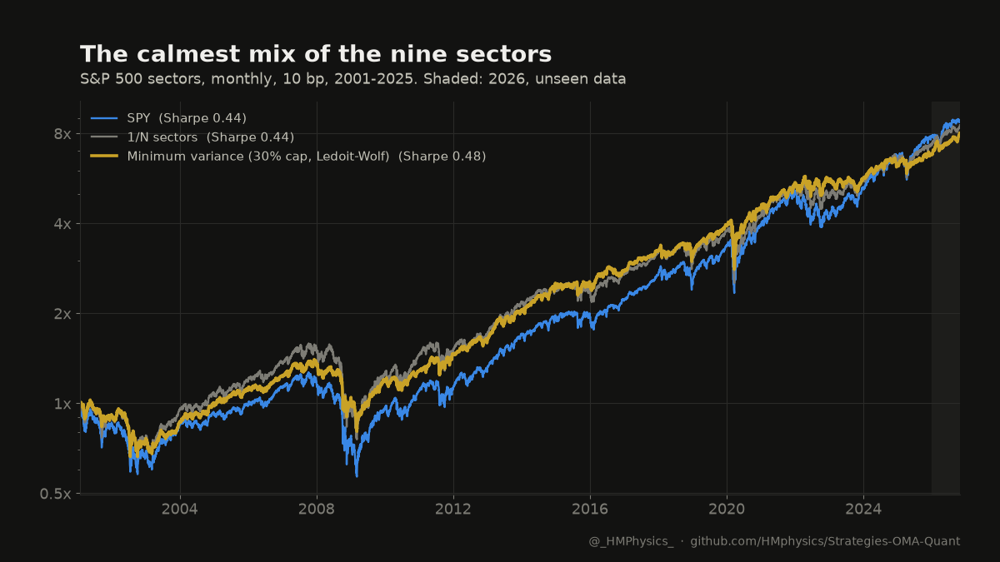
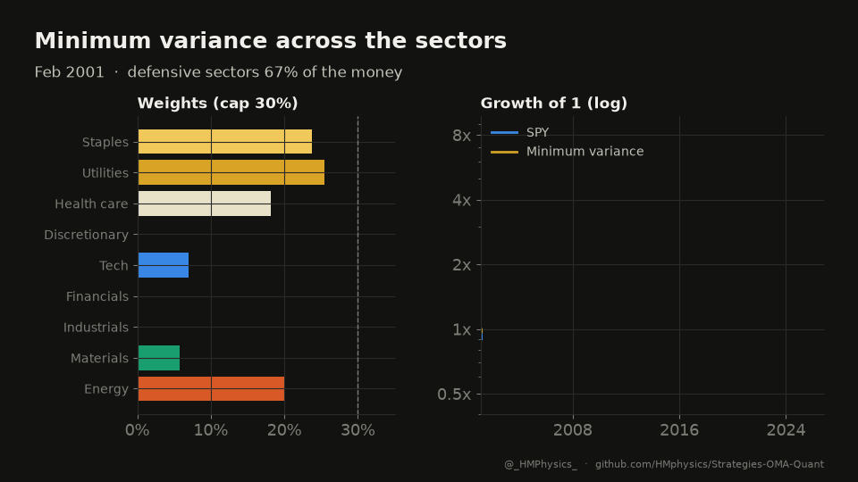
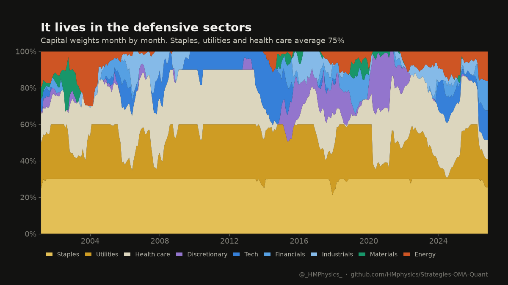
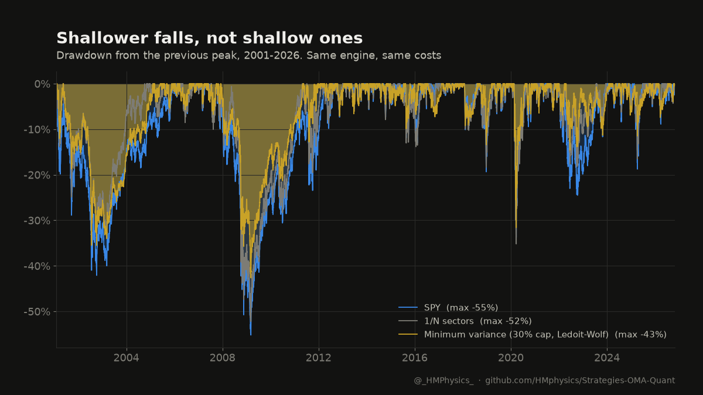
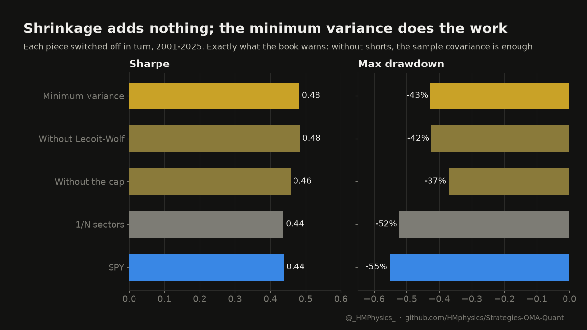
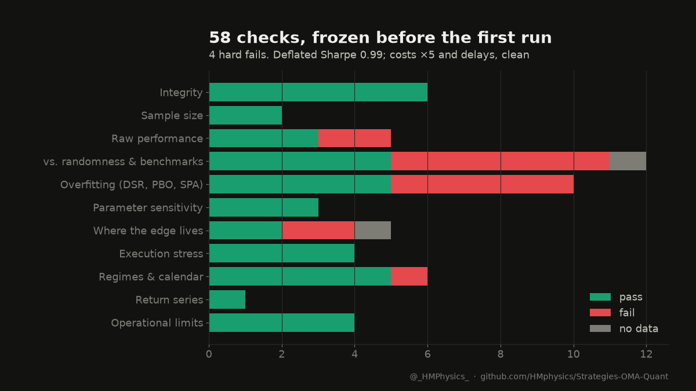

# Strategy 6 · Minimum variance across the sectors

**216 Quant Books · Episode 6** · Book 1 of 216 · Daniel P. Palomar, *Portfolio Optimization: Theory and Application* (Cambridge, 2025)

**[📚 The series on Substack](https://hmaquant.substack.com/s/216-quant-books)** · **[𝕏 @_HMPhysics_](https://x.com/_HMPhysics_)**

> **English** below · **[Español más abajo](#-español)**

## The idea

Low-volatility stocks have historically earned about as much as risky ones, with less risk. It's one of the best-documented anomalies in finance, and the global minimum variance portfolio (GMVP) is the purest way to harvest it: it needs no return forecasts at all, only the covariance between assets.

We applied it to the nine original sectors of the S&P 500, with the two fixes the book recommends: no short selling and a cap per sector.

## How it plays

| | |
|---|---|
| **Universe** | XLB, XLE, XLF, XLI, XLK, XLP, XLU, XLV, XLY (the nine original SPDR sectors) |
| **Rebalance** | Monthly, at the close of the last session |
| **Estimate** | Covariance of the last 252 daily returns, shrunk with Ledoit-Wolf |
| **Weights** | Minimum variance, long only, never more than 30% in one sector |
| **Costs** | 10 bp per side |
| **Sample** | February 2001 to December 2025, plus 2026 as unseen data |

The weights press against the 30% cap in the calm sectors almost all the time: staples, utilities and health care hold about three quarters of the money on average.

## The record

| | Sharpe | CAGR | Vol | Max DD | 2026 Sharpe | 2026 Max DD |
|---|:-:|:-:|:-:|:-:|:-:|:-:|
| **Minimum variance (30% cap, Ledoit-Wolf)** | **0.48** | **8.0%** | **14.8%** | **−42.6%** | **1.84** | **−7.4%** |
| Without Ledoit-Wolf | 0.48 | 8.0% | 14.8% | −42.4% | 1.75 | −7.5% |
| Without the cap | 0.46 | 7.4% | 14.2% | −37.1% | 1.92 | −7.7% |
| 1/N sectors | 0.44 | 8.3% | 18.3% | −52.2% | 1.49 | −6.4% |
| SPY, buy and hold | 0.44 | 8.6% | 19.2% | −55.2% | 0.98 | −8.9% |

Same engine and costs for every line. 2026 runs from January to October. Sharpe over the T-bill rate.

A slightly better return per unit of risk than the market, with a quarter less volatility and 12 points less drawdown. And the book was right: switching off the Ledoit-Wolf shrinkage changes nothing, because once short selling is off the table the sample covariance is good enough.

## What the engine checked

YGGDRASIL runs the same 58 checks on every strategy, with thresholds frozen before the first run.

**Where it does well**
- Deflated Sharpe 0.99: the edge over the market is not luck.
- Execution stress, clean: costs ×5 give 0.45, a day late 0.48. Low turnover, about 1.2 times a year.
- Stable: every window and cap we tried lands between 0.45 and 0.51; positive in 20 of 25 years.
- A strong 2026 so far on unseen data (Sharpe 1.84, +17%).

**Where it struggles**
- Sharpe 0.48 against a house bar of 0.8, only 0.04 above SPY.
- The timing test fails: shuffling the weights in time doesn't hurt it. It earns from what it holds, not from when it moves.
- Without its five best trades the Sharpe turns negative (−0.20).
- Three defensive sectors carry the portfolio, so it lags in tech-led rallies; −43% at its worst is still a big fall.

## The verdict

**🟡 A middle-ground strategy. It doesn't clear YGGDRASIL's bar, but it beats the index it was built from.**

Minimum variance across the sectors does what the low-volatility anomaly promises: a slightly better return per unit of risk than the market, with less volatility and smaller falls, and it survives costs and delays. The advantage over a plain index fund is small, it leans heavily on three defensive sectors, and −43% is not a calm portfolio. Worth knowing and worth studying, not quite worth our capital.

**[Open the full visual report](report.html)** (download and open in your browser).

---

## 🇪🇸 Español

**216 libros quant · Episodio 6 · Estrategia 6 de la serie · Libro 1:** Palomar, *Portfolio Optimization* (2025).

**La idea.** La cartera de mínima varianza de los 9 sectores del S&P 500, sin cortos y con un máximo del 30 % por sector, para aprovechar la anomalía de baja volatilidad.

**Cómo juega.** Covarianza de un año con shrinkage de Ledoit-Wolf, rebalanceo mensual y 10 pb por lado. De media, el 75 % del dinero está en consumo básico, utilities y salud.

**Resultados 2001-2025.** Sharpe 0,48 frente a 0,44 del SPY y de 1/N, con 14,8 % de volatilidad (19,2 % el SPY) y una caída máxima del −43 % (−55 % el SPY). El shrinkage no aporta nada, como predice el libro.

**El motor.** Sharpe deflactado de 0,99, aguanta costes ×5 y el retraso, y es positiva en 20 de 25 años. Falla el Sharpe (0,48 frente a 0,8), el timing y la dependencia de sus mejores operaciones.

**Veredicto: 🟡 estrategia media.** Un poco mejor que el índice y bastante más tranquila, pero por debajo del listón. Para conocerla y estudiarla, sí; para meterle capital, todavía no.

---

**🌳 About YGGDRASIL and OMA Quant**

YGGDRASIL is the audit engine behind this series: the verdict is sealed before the backtest, every strategy faces 58 checks, and every attempt raises the bar.
It's built by **[OMA Quant](https://www.omaquant.com/pricing?cupon=OMAQUANT-10)**, a quantitative research house for independent investors: live strategy signals, macro and derivatives research, market data and research tools.
Run the same engine on your own strategies with **[OMA Lab](https://www.omaquant.com/lab?cupon=OMAQUANT-10)**.

*YGGDRASIL es el motor de auditoría de esta serie: el veredicto se sella antes del backtest, cada estrategia pasa 58 comprobaciones y cada intento sube el listón. Lo construye [OMA Quant](https://www.omaquant.com/pricing?cupon=OMAQUANT-10), una casa de research cuantitativo para inversores independientes.*

⭐ **[Star the repo](https://github.com/HMphysics/Strategies-OMA-Quant)** to follow the 216 books · If it's useful, share it: **`OMAQUANT-10`** gives you **[10% off OMA Quant](https://www.omaquant.com/pricing?cupon=OMAQUANT-10)**

Book: Daniel P. Palomar, Portfolio Optimization: Theory and Application, Cambridge University Press, 2025 (free at portfoliooptimizationbook.com). GMVP in section 6.5.1, caps in 7.1.5, Ledoit-Wolf shrinkage in 3.6.1. Educational content, not financial advice. Backtests do not guarantee future returns.
